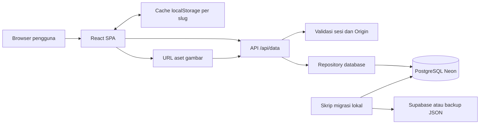
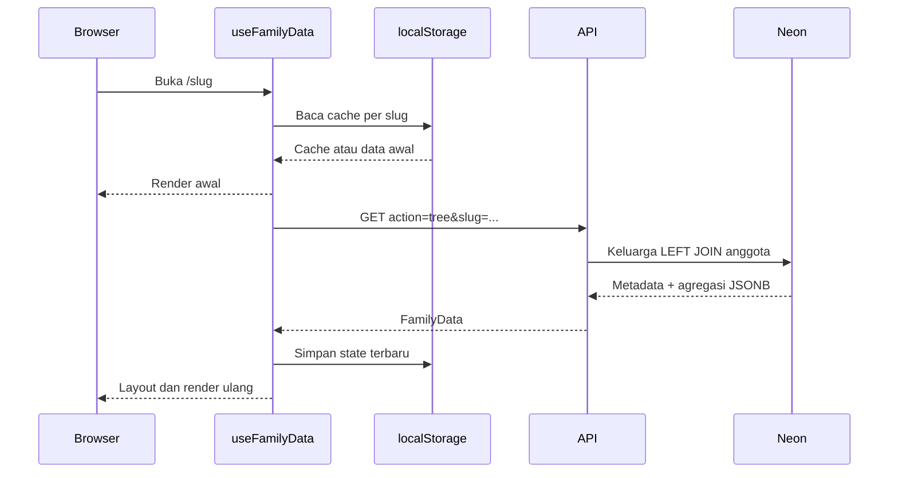

# Arsitektur Sistem — Silsilah Keluarga

Tanggal acuan: 21 Oktober 2026. Versi aplikasi: `0.2.0`.
Status: dokumentasi implementasi rilis v0.2.0. Kebutuhan: [PRD.md](PRD.md); kontrak data/API: [Schema.md](Schema.md); antarmuka: [Design.md](Design.md).

## 1. Gambaran sistem

Aplikasi terdiri dari SPA React 19 dan TypeScript, endpoint Node.js, serta PostgreSQL Neon. Vite 8 membangun frontend; handler API yang sama digunakan oleh middleware lokal/preview dan fungsi Vercel. Tidak ada React Router, ORM, atau layanan Supabase pada jalur runtime aktif.



Neon diakses melalui `@neondatabase/serverless` dengan SQL bertag dan parameter terikat. Browser hanya mengakses API same-origin; `DATABASE_URL` tidak masuk bundle frontend.

## 2. Struktur proyek dan tanggung jawab

```text
api/data.mjs                    Handler HTTP dan pemeriksaan akses
server/database.mjs             DDL aktif, validasi dasar, query/transaksi
server/session.mjs              Password, cookie dan signature HMAC
src/
  main.tsx                      Entry React
  App.tsx                       Routing, mode eksplorasi, state peta/profil
  types/family.ts               Kontrak domain dan tipe layout
  data/changelog.ts             Data rilis dan sumber versi UI
  hooks/
    useFamilyData.ts            Cache, load remote, perubahan anggota/metadata
    useAdminSession.ts          State sesi dan operasi login/logout
    usePanZoom.ts               Kamera, drag, wheel, sentuh, fit/fly
    useAccessibleDialog.ts      Fokus modal, Tab dan Escape
  services/databaseService.ts   Klien fetch API dan upload
  utils/
    layoutEngine.ts             Koordinat node dan jalur relasi
    clusterEngine.ts            Kelompok keluarga, tier zoom dan culling
    zoomSpacing.ts              Faktor pembukaan horizontal subtree
    viewport.ts                 Perhitungan fit kamera
    gallery.ts                  Gabung foto dan tag sesuai profil aktif
    updateFamilyMembers.ts      Hubungan pasangan dan urutan anak
    familyCatalog.ts            Gabungan katalog remote/cache untuk admin
    imageOptimizer.ts           Resize dan kompresi gambar browser
    dateUtils.ts                Tanggal, umur dan label generasi
  components/
    LandingPage.tsx              Halaman pengenalan
    ChangelogPage.tsx            Timeline rilis publik /changelog
    ChangelogPage.css            Gaya timeline responsif
    AdminArea.tsx                Login, dashboard dan pengelolaan
    Navbar.tsx                  Identitas, pencarian dan tindakan
    FamilyExplorer.tsx          Daftar anggota dan filter
    FamilyOverview.tsx          Kartu/ringkasan keluarga
    TreeCanvas.tsx              Dunia HTML node dan garis SVG
    NodeCard.tsx / ClusterCard.tsx
    Controls.tsx / Minimap.tsx / LegendPanel.tsx
    MemberDetailModal.tsx / MemberFormModal.tsx
    PhotoCarousel.tsx / ImageLightboxModal.tsx / ImageCropModal.tsx
    TreeSettingsModal.tsx / DatabaseModal.tsx / SmartDatePicker.tsx
  index.css / warm-theme.css    Token, gaya global dan override tema
scripts/                        Setup, migrasi, verifikasi dan pembacaan env
tests/*.test.mjs                Unit dan pengujian API dengan dependency injection
tests/browser/family.spec.mjs   Regresi UI Playwright
tests/browser/admin-delete.spec.mjs  Pembatalan, keberhasilan dan kegagalan hapus keluarga
public/                         Aset statis
supabase_schema.sql             Skema sumber historis, bukan DDL Neon aktif
vite.config.ts                  Middleware API dev/preview
vercel.json                     Rewrite SPA/API dan cache bundle
PRD.md / Design.md / Schema.md / Architecture.md / CHANGELOG.md
```

## 3. Routing dan state aplikasi

`App.tsx` membaca pathname, menggunakan History API, dan mendengarkan `popstate`. `/` menampilkan landing; `/admin/dashboard`, `/admin/login`, dan `/admin/manage` memakai `AdminArea`; path lain diperlakukan sebagai slug keluarga. Mengubah keluarga me-remount `FamilyTreeApp` melalui key slug.

Pengecualian route publik `/changelog` dirender sebelum pemrosesan keluarga. Halaman ini menggunakan data statis `src/data/changelog.ts`, tanpa koneksi database. Footer versi hanya ada di beranda. `changelog` dicadangkan dalam validasi slug klien/server untuk mencegah benturan alamat keluarga. Release gate memeriksa keselarasan versi UI, package, lockfile, dan dokumentasi melalui `tests/release.test.mjs`.

State keluarga/profil/kamera berada pada React hooks. `showOverview` awal false, sehingga URL keluarga membuka peta pada 85%. Posisi awal disesuaikan setelah pemuatan cloud selesai. Mode peta keluarga, ringkasan, profil, dan panel lain tidak memiliki route terpisah. Referensi state menyimpan kamera dan posisi scroll untuk navigasi kembali di dalam eksplorasi.

## 4. Alur data

### 4.1 Pembacaan keluarga



Remote merupakan sumber persistensi bersama, tetapi cache/data awal dapat tetap tampil ketika request gagal atau keluarga tidak ditemukan. Hook saat ini belum mengubah seluruh kegagalan tersebut menjadi halaman error/404 khusus. Cache bukan sistem offline sync.

### 4.2 Perubahan anggota

Form mengumpulkan profil, hubungan, urutan anak, dan URL foto. Gambar dapat di-crop dan dioptimalkan di browser sebelum POST aset. Klien memperbarui pasangan timbal balik dan urutan anak, lalu menyimpan melalui operasi anggota atau sinkronisasi pohon sesuai alur UI. Beberapa alur mengubah state lokal sebelum respons remote selesai; kegagalan penyimpanan belum memiliki mekanisme rollback/retry yang seragam.

Penulisan pohon meng-upsert metadata dan payload anggota dalam transaksi; penulisan anggota dan timestamp juga transaksional. Transaksi satu request tidak menjamin konsistensi beberapa request klien, terutama ketika banyak record pasangan diperbarui terpisah. Tidak ada optimistic concurrency/version check untuk multi-editor.

### 4.3 Login dan akses

POST sesi membandingkan password terhadap `ADMIN_PASSWORD` dengan `timingSafeEqual`, lalu mengirim cookie bertanda tangan HMAC. Setiap request tulis dan GET katalog memverifikasi cookie server. Sesi di browser diverifikasi kembali lewat GET sesi. Origin pada request non-GET diperiksa jika header tersedia.

Pengunjung tetap dapat membaca keluarga dan aset tanpa sesi. Satu admin memiliki akses seluruh keluarga; belum ada tenant authorization, MFA, rate limiting login, atau audit log. Logout menghapus cookie browser, bukan mencabut token yang pernah disalin. Rotasi secret memutus validitas seluruh signature lama.

Admin yang sudah login dialihkan dari `/admin` dan `/admin/login` ke `/admin/dashboard`, serta dari `/manage` ke `/admin/manage`. Kedua rute baru memerlukan login. Navbar silsilah menampilkan tautan Dashboard admin bagi sesi admin; tabel keluarga hanya dirender pada halaman pengelolaan.

### 4.3.1 Penghapusan permanen keluarga

Setelah konfirmasi browser, `AdminArea` memanggil `deleteFamilyTree` melalui DELETE `/api/data?action=tree&slug=...`. Server memeriksa sesi, Origin bila tersedia, dan validitas slug. `removeTree` menjalankan DELETE terparameter pada `family_trees`; FK `ON DELETE CASCADE` menghapus seluruh anggota keluarga tersebut. Operasi bersifat idempoten, termasuk keluarga yang hanya tersimpan lokal. Setelah respons berhasil, klien menghapus cache slug, menutup editor terkait, dan memperbarui daftar. Jika server gagal, cache dan daftar tetap tersedia. Aset foto tidak memiliki `tree_id` sehingga tidak ikut dihapus. Cache pada perangkat lain dan konflik multi-editor belum disinkronkan.

### 4.4 Kinerja, cache, dan batasnya

- Clustering mengurangi jumlah entitas pada zoom jauh, sementara culling memakai batas viewport dengan buffer bawaan 300px.
- Pohon kecil dan expand-all melewati clustering/culling di `TreeCanvas`; ini mempertahankan detail tetapi dapat menambah biaya DOM.
- Layout dimemoisasi berdasarkan data dan skala; perubahan skala pada peta besar dapat memicu layout ulang. Tidak ada Web Worker atau indeks spasial khusus.
- Gambar di-resize/kompresi melalui Canvas browser, dengan WebP dan fallback JPEG; thumbnail membantu node peta.
- Aset API dan bundle `/assets/*` memakai cache immutable satu tahun; respons JSON API memakai no-store. Cache keluarga disimpan per slug di localStorage.
- API membaca satu pohon lengkap dan mengagregasi seluruh payload anggota. Belum ada pagination anggota, lazy-load per keluarga kecil, atau lazy-load field profil. Penyimpanan gambar base64 dalam PostgreSQL menambah overhead ukuran.

Belum ada hasil benchmark yang menetapkan kapasitas maksimum anggota, latensi p95, atau target throughput. Fitur di atas menjelaskan mekanisme, bukan klaim peningkatan terukur.

## 5. Algoritma visualisasi

### Layout

`computeFamilyTreeLayout` membangun generasi efektif dari data, menyesuaikan generasi berdasarkan orang tua/pasangan melalui iterasi terbatas, menghitung lebar subtree, lalu menempatkan node dan jalur SVG. Parameter dasar: node 120, gap horizontal 140, pasangan 90, vertikal 280 dalam satuan dunia.

Untuk peta seluruh keluarga dengan lebih dari 12 node dan skala di bawah 0,85, `App` meminta layout adaptif. Lebar subtree diinterpolasi antara lebar ringkas dan lebar penuh menggunakan `smoothstep(t) = t²(3−2t)`. Generasi II membuka pada 0,28–0,5; generasi III ke bawah pada 0,5–0,85. Peta keluarga terpilih menggunakan koordinat penuh agar ukuran/jarak konsisten pada skala detail.

### Clustering

Tier skala: macro `<0,5`, medium `<0,85`, micro selebihnya. Kelompok dibangun berdasarkan garis keturunan dan pasangan yang memenuhi aturan engine; penelusuran menyertakan anak dari pasangan yang masuk kelompok. Hal ini mencegah anak yang hanya menunjuk pasangan terpisah dari kelompok keluarganya. Target klik cluster dipetakan kembali ke bounds layout penuh sebelum kamera memperbesar.

### Kamera dan label

World layer memakai `translate3d(x,y,0) scale(s)`. Hook membatasi skala 0,08–2,5 dan mendukung pan, pinch, zoom bertitik pusat, reset 0,85, fit, dan fly-to. Fit memakai padding 35px mobile/65px desktop dan membatasi hasil hingga 1,15. Batas minimum skala berarti pohon ekstrem tetap dapat lebih besar daripada layar.

Badge generasi memakai inverse scale. Pada mobile, x dunia dihitung dari `(8 - viewport.x) / scale` agar posisi layar tetap di kiri; y tetap mengikuti generasi dengan offset di atas node. Mode macro membatasi label ke generasi I–II. Peta keluarga terpilih menghitung ulang jumlah anggota tiap label berdasarkan node yang ditampilkan.

### Galeri

`getAssociatedGalleryPhotos` menggabungkan foto sendiri dan foto pemilik lain yang menandai anggota aktif. Map berdasarkan URL mendeduplikasi foto. Set peserta menggabungkan pemilik dan tag, mengecualikan profil aktif serta ID yang tidak dikenal. Hasil hanya untuk tampilan; payload asli tidak dimutasi.

## 6. Penyimpanan dan evolusi skema

Tabel aktif: `family_trees`, `family_members`, `family_assets`; rinciannya ada di [Schema.md](Schema.md). JSONB memudahkan penambahan atribut profil tanpa kolom baru, tetapi integritas hubungan merupakan tanggung jawab aplikasi. Setup saat ini membuat tabel jika belum ada; belum ada runner migrasi skema berversi.

Skrip migrasi Supabase mendukung dry-run, backup, merge eksplisit, dan verify. Skrip tidak mengubah sumber. Jalankan terhadap target yang disengaja; migrasi dan setup bukan bagian otomatis dari request runtime.

## 7. Konfigurasi dan operasi

Gunakan Node.js 24 sesuai README. Konfigurasi server: `DATABASE_URL`, `ADMIN_PASSWORD`, `ADMIN_SESSION_SECRET` minimal 32 karakter. Variabel `SUPABASE_SOURCE_URL` dan `SUPABASE_SOURCE_KEY` hanya diperlukan untuk migrasi. Jangan memakai prefiks `VITE_` pada rahasia; jangan memasukkan nilai rahasia ke dokumentasi atau repository.

```sh
npm install
# Buat .env.local dari .env.example dan isi konfigurasi server.
npm run db:setup
npm run dev
```

Dev dan preview memasang handler API lewat plugin Vite. Produksi Vercel mengeksekusi `api/data.mjs`, sedangkan rewrite meneruskan route aplikasi ke SPA. Secret sesi harus konsisten antar-instance pada satu environment. Perubahan env lokal tidak memperbarui Vercel.

## 8. Validasi dan observabilitas

```sh
npm test
npm run lint
npm run build
npm run test:ui
```

Node tests mencakup API, sesi, data admin/migrasi, fit viewport, clustering, jarak zoom, dan galeri. Browser suite memakai API mock agar hasil stabil, termasuk regresi mobile, masuk peta, hover, back setelah drag, label generasi, dan anak pada profil. Konfigurasi default browser menjalankan Vite di `127.0.0.1:5175` dengan kanal Edge; port harus tersedia dan browser terpasang. Tes mock tidak membuktikan koneksi database produksi; verifikasi migrasi/Neon dijalankan terpisah.

Saat ini observabilitas terutama berupa console klien dan pesan error API umum. Belum ada tracing, metrik produksi, error tracking terpusat, atau prosedur backup otomatis yang dibuktikan oleh kode. Penambahan kapasitas besar, akses privat, dan kolaborasi memerlukan desain lanjutan untuk integritas graf, aset, konflik, dan hak akses.
