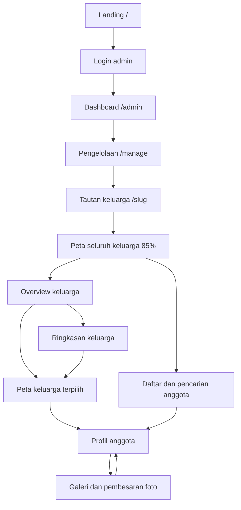

# Desain Antarmuka — Silsilah Keluarga

Tanggal acuan: 21 Oktober 2026. Versi aplikasi: `0.1.0`.
Dokumen ini menjelaskan desain yang diimplementasikan pada workspace saat ini. Kebutuhan produk dijelaskan di [PRD.md](PRD.md).

## 1. Prinsip desain

- Utamakan hubungan keluarga dan foto; peta menjadi area utama, sementara kontrol mendukung eksplorasi.
- Gunakan bahasa Indonesia yang akrab: “Keluarga [nama]”, “Jelajahi peta”, “Daftar anggota”, dan “Lihat seluruh keluarga”.
- Pertahankan ukuran node yang nyaman dibaca. Pohon boleh melampaui viewport dan digeser.
- Tampilkan ringkasan saat ruang terbatas; buka detail berdasarkan zoom atau pilihan pengguna.
- Gunakan nuansa album keluarga: krem, terakota, sage, peach, garis halus, dan sudut membulat.

## 2. Arsitektur informasi

Keluarga dipilih melalui URL; overview adalah mode di dalam halaman keluarga, bukan route tersendiri. Pemilihan profil juga merupakan state modal, bukan URL profil permanen.

Footer beranda menampilkan tautan “Catatan rilis” dan badge versi monospace tanpa pemenggalan. Halaman publik `/changelog` menggunakan tema yang sama dengan beranda, tautan kembali, serta timeline kartu rilis berisi versi, tanggal, penanda terbaru, dan kategori perubahan. Tidak ada footer versi tambahan pada halaman keluarga, admin, atau changelog.

## 3. Sistem visual

Token utama berada di `src/index.css`; override tema dan desktop di `src/warm-theme.css`.

| Token | Nilai | Pemakaian |
| --- | --- | --- |
| `--bg-main` | `#fff9f1` | Latar utama |
| `--bg-secondary` | `#fffdf9` | Permukaan kartu |
| `--text-primary` | `#3e3028` | Teks utama |
| `--text-secondary` | `#796b60` | Teks penjelas |
| `--text-muted` | `#877266` | Metadata |
| `--accent-gold` | `#b95f3c` | Aksen terakota; nama token dipertahankan dari implementasi |
| `--accent-emerald` | `#42816a` | Aksen hijau |
| `--accent-cyan` | `#397c8a` | Fokus dan aksen teal |
| `--accent-rose` | `#b44c62` | Aksen relasi/status |
| Radius | 8 / 14 / 20 / 9999 px | Kontrol, kartu, panel, pill |

Tipografi: Plus Jakarta Sans untuk isi, Outfit untuk judul/node, Playfair Display untuk judul editorial tertentu. Font dimuat dari Google Fonts dengan fallback sistem. Ikon memakai `lucide-react`. Bayangan menggunakan warna cokelat transparan; permukaan terang tidak memakai kontras neon.

## 4. Tata letak layar

### Desktop

Pada lebar minimal 769px, mode peta memakai navbar ringkas, toolbar eksplorasi satu baris, breadcrumb di dalam area peta, dan kontrol bawah mendatar. Peta mulai 100px dari atas dan menyisakan 64px di bawah. Tombol ikon zoom berukuran 38px; tombol tindakan utama pada kontrol bawah memiliki tinggi minimal 44px. Pada rentang 769–1100px, beberapa kontrol sekunder dipindahkan/disembunyikan sesuai CSS.

Peta tidak otomatis di-fit saat masuk. Zoom 85% mempertahankan keterbacaan; tombol “Lihat seluruh keluarga” adalah pilihan eksplisit untuk merangkum pohon.

### Mobile

Hook kamera memakai batas lebar `<768px`; sebagian aturan CSS memakai `max-width:768px`. Kontrol peta utama berukuran 48px dan memperhitungkan safe area bawah. Panel tambahan menggunakan menu/drawer agar ruang peta tersedia. Pemilihan kartu keluarga membuka ringkasan terlebih dahulu, dengan tindakan untuk membuka peta keluarga.

Badge generasi dipasang sekitar 8px dari kiri area peta. Badge mengikuti koordinat vertikal generasi, tetapi tidak ikut mengecil bersama dunia peta. Garis bantu generasi disembunyikan pada mobile. Ketika baris bergeser keluar viewport, badge baris tersebut ikut keluar; badge bukan daftar generasi yang selalu terlihat seluruhnya.

## 5. Peta, node, dan zoom

| State kamera | Representasi |
| --- | --- |
| Awal/reset | 85%, node terbaca, area di luar layar dapat digeser |
| Macro `<50%` | Cluster keluarga, label generasi I–II |
| Medium `50%–<85%` | Detail bertahap menurut clustering |
| Micro `>=85%` | Detail anggota |
| Sangat jauh `<16%` | Badge ringkas “Gen I” beserta angka anggota |

Pohon dengan maksimal 12 node serta mode expand-all menggunakan node individual tanpa clustering. Persentase kamera bukan ukuran CSS langsung setiap elemen: node/cluster memiliki kompensasi skala visual dan badge generasi memakai inverse scale agar tetap terbaca.

Layout dasar memakai ukuran node dunia 120, gap horizontal 140, gap pasangan 90, dan jarak vertikal generasi 280. Ukuran ini adalah parameter algoritma; bounding box kartu akhir juga mencakup nama, avatar, dan transform visual. Jarak subtree generasi II membuka bertahap pada skala 0,28–0,5, generasi III ke bawah pada 0,5–0,85.

Node menampilkan avatar/inisial, nama, dan metadata relevan. Pilihan node membuka profil. Hover cluster menampilkan anggota; celah menuju panel dijembatani area hover dan penutupan ditunda 300ms. Scroll di panel anggota tidak memperbesar atau memperkecil peta.

Relasi menggunakan garis SVG dengan warna dan gaya berbeda: pasangan aktif terakota, orang tua biologis hijau, serta adopsi biru dengan gaya khusus. Detail tipe garis mengikuti `LayoutEdge` dan legenda; tipe domain foster/step tidak memiliki enum edge terpisah.

## 6. Overview dan pencarian

Overview memakai kartu keluarga yang dapat dipindai, nama pemimpin kelompok, dan jumlah anggota. Angka mencakup anggota yang benar-benar dikelompokkan, termasuk anak yang relasinya hanya tercatat pada pasangan.

Daftar anggota menyediakan input pencarian, filter generasi, jumlah hasil, dan state kosong. Hasil membuka profil. Navbar juga menyediakan autocomplete dengan navigasi keyboard. Navigasi kembali mengembalikan konteks peta/overview yang disimpan aplikasi; klik setelah drag tidak boleh terbuang.

## 7. Profil dan foto

Urutan konten profil mengikuti implementasi: hero identitas, atribut dan kisah hidup yang tersedia, dokumentasi/galeri, silsilah keturunan, hubungan langsung, serta tindakan admin bila memiliki sesi.

- Silsilah dikelompokkan per generasi keturunan dengan badge jumlah dan daftar yang dapat dibuka/ditutup.
- Anak ditampilkan satu kali di silsilah; urutan serta jenis hubungan tetap tersedia di chip.
- Hubungan langsung memuat orang tua, pasangan, dan saudara tanpa mengulang daftar anak.
- Nama pada chip/tag membuka profil anggota terkait.
- Galeri menggabungkan kepemilikan dan tag, deduplikasi berdasarkan URL, lalu mengecualikan profil aktif dari tag yang ditampilkan.
- Filter kenangan/sepia pada foto profil tidak mengubah warna foto galeri.

## 8. Aksesibilitas dan interaksi

Dialog yang menggunakan `useAccessibleDialog` memindahkan fokus saat dibuka, menjebak Tab, menutup lewat Escape pada overlay teratas, dan mengembalikan fokus saat ditutup. Tombol peta memiliki label aksesibel serta state disabled pada batas zoom. Node menyediakan role button dan indikator fokus.

Pedoman pemeliharaan: jangan menyampaikan hubungan hanya melalui warna; pertahankan teks/legenda, target sentuh mobile, nama aksesibel, dan pilihan reduced-motion pada animasi yang mendukungnya. Masih diperlukan audit keyboard untuk seluruh chip dan accordion, serta pengukuran kontras menyeluruh sebelum mengklaim kepatuhan WCAG.

## 9. State dan pemeriksaan desain

State penting: sinkronisasi cloud, hasil pencarian kosong, login gagal, operasi penyimpanan gagal, gambar tanpa avatar, anggota wafat, batas zoom, preview hover, modal bertumpuk, dan keluarga dengan relasi tidak lengkap. Cache/fallback dapat tetap tampil ketika remote gagal; UI saat ini belum membedakan seluruh kasus kegagalan secara rinci.

Periksa layar 320px, 390px, tablet di sekitar breakpoint 768px, dan desktop 1440px. Skenario utama: masuk langsung ke peta, fit/reset, pan/pinch, membuka keluarga, kembali setelah drag, scroll preview, membaca generasi, profil anak tanpa duplikasi, dan galeri dari beberapa profil. Pengujian browser berada di `tests/browser/family.spec.mjs`.
