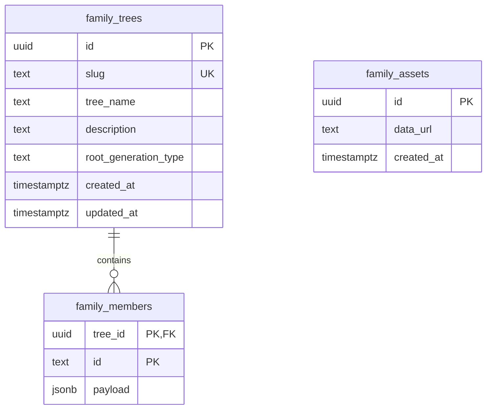

# Skema Data dan Kontrak API

Tanggal acuan: 21 Oktober 2026. Versi aplikasi: `0.1.0`.
Sumber utama: `server/database.mjs`, `src/types/family.ts`, dan `api/data.mjs`.

## 1. Penyimpanan aktif

Database aktif adalah PostgreSQL Neon. Metadata keluarga disimpan relasional, profil anggota sebagai JSONB, dan gambar sebagai data URL pada tabel aset. `supabase_schema.sql` adalah skema historis untuk sumber migrasi dan tidak menggambarkan tabel Neon aktif.



Foto direferensikan melalui URL di JSONB, bukan foreign key ke `family_assets`. Tidak ada tabel sesi atau pengguna pada skema aktif.

## 2. DDL aktif

Berikut representasi DDL dari `initializeDatabase`; jalankan penyiapan melalui `npm run db:setup`.

```sql
CREATE TABLE IF NOT EXISTS family_trees (
  id uuid PRIMARY KEY DEFAULT gen_random_uuid(),
  slug text UNIQUE NOT NULL,
  tree_name text NOT NULL,
  description text NOT NULL DEFAULT '',
  root_generation_type text,
  created_at timestamptz NOT NULL DEFAULT now(),
  updated_at timestamptz NOT NULL DEFAULT now()
);
CREATE TABLE IF NOT EXISTS family_members (
  tree_id uuid NOT NULL REFERENCES family_trees(id) ON DELETE CASCADE,
  id text NOT NULL,
  payload jsonb NOT NULL,
  PRIMARY KEY (tree_id, id)
);
CREATE TABLE IF NOT EXISTS family_assets (
  id uuid PRIMARY KEY,
  data_url text NOT NULL,
  created_at timestamptz NOT NULL DEFAULT now()
);
```

Primary key dan unique constraint menyediakan indeks implisit. Tidak ada indeks JSONB tambahan atau indeks generasi khusus pada initializer aktif. `CREATE TABLE IF NOT EXISTS` tidak memperbarui struktur tabel lama yang kolomnya belum sesuai; perubahan skema berikutnya membutuhkan migrasi eksplisit.

## 3. Objek keluarga

| Field `FamilyData` | Tipe | Penyimpanan/keterangan |
| --- | --- | --- |
| `id`, `treeId` | string opsional | Keduanya diisi ID keluarga oleh pembacaan server |
| `slug` | string opsional di TypeScript | Wajib dan valid untuk penulisan server |
| `familyTreeName` | string | `tree_name`, wajib tidak kosong |
| `description` | string opsional | `description`, default kosong |
| `rootGenerationType` | enum opsional | `root_generation_type`, nullable |
| `members` | record ID ke anggota | Hasil agregasi `family_members.payload` |
| `updatedAt` | string | Waktu keluarga dari database; klien juga mengubah timestamp lokal |

`rootGenerationType`: `gantungsiwur`, `udhegudheg`, `wareng`, `canggah`, `buyut`, `kakek`, atau `orangtua`. Sebutan generasi dihitung di `dateUtils.ts`, tidak disimpan sebagai label per anggota.

## 4. Payload anggota

Seluruh field berikut berada di `family_members.payload`, menggunakan camelCase.

| Kelompok | Field dan tipe |
| --- | --- |
| Identitas wajib pada tipe | `id: string`, `fullName: string`, `gender: Gender`, `generation: number`, `isDeceased: boolean` |
| Nama tambahan | `nickname?`, `titlePrefix?`, `titleSuffix?`, `title?`: string; `title` adalah fallback lama |
| Kelahiran | `birthDate?`, `birthPlace?`: string |
| Wafat | `passedDate?`, `passedPlace?`, `burialPlace?`: string |
| Latar belakang | `education?`, `occupation?`, `workplace?`, `residence?`, `bio?`: string |
| Kontak | `phone?`, `email?`, `socialMedia?`: string |
| Foto | `avatar: string`, `thumbnail?: string`, `gallery?: GalleryPhoto[]` |
| Relasi | `parentIds: string[]`, `relationshipToParents: ParentRelationType`, `spouses: SpouseRelation[]` |
| Tambahan | `order?: number`, `tags?: string[]` |

Tanggal didukung sebagai string, umumnya `YYYY-MM-DD`, dan sebagian data lama dapat berupa teks. Tidak ada tipe SQL date atau pemeriksaan kalender pada JSONB.

| Enum | Nilai |
| --- | --- |
| `Gender` | `male`, `female`, `other` |
| `ParentRelationType` | `biological`, `adopted`, `foster`, `step` |
| `MarriageStatus` | `married`, `divorced`, `separated`, `widowed` |

`SpouseRelation`: `spouseId` dan `status` wajib pada tipe; `marriageDate`, `divorceDate`, dan `note` opsional. `GalleryPhoto`: `id` dan `url` wajib; `caption`, `date`, dan `taggedMemberIds: string[]` opsional.

Contoh sintetis, bukan salinan data keluarga:

```json
{
  "slug": "keluarga-contoh",
  "familyTreeName": "Keluarga Contoh",
  "rootGenerationType": "kakek",
  "updatedAt": "2026-10-21T00:00:00Z",
  "members": {
    "anggota-1": {
      "id": "anggota-1",
      "fullName": "Nama Contoh",
      "gender": "male",
      "generation": 1,
      "isDeceased": false,
      "avatar": "",
      "parentIds": [],
      "relationshipToParents": "biological",
      "spouses": [],
      "gallery": []
    }
  }
}
```

## 5. Integritas dan semantik penulisan

- Slug `admin`, `manage`, `api`, dan `changelog` dicadangkan untuk route sistem dan ditolak pada validasi server.
- `(tree_id, id)` adalah identitas unik anggota; ID yang sama dapat dipakai di keluarga berbeda.
- `validateFamily` memeriksa slug, nama keluarga, bentuk record anggota, kecocokan key dengan `member.id`, nama anggota, serta array orang tua/pasangan. Server belum memvalidasi seluruh field/enum TypeScript.
- Hubungan orang tua/pasangan/tag adalah referensi logis dalam JSONB. Database tidak menolak ID target yang hilang, siklus keturunan, atau pasangan tidak simetris.
- Klien memperbarui hubungan pasangan timbal balik dan urutan anak. API penulisan satu anggota sendiri tidak menyinkronkan record pasangannya.
- `writeTree` meng-upsert metadata berdasarkan slug dan anggota berdasarkan primary key dalam transaksi. Anggota lama yang tidak ada pada kiriman tidak dihapus.
- `writeMember` meng-upsert satu payload dan memperbarui timestamp keluarga dalam transaksi.
- `removeMember` menghapus record, membersihkan referensi orang tua/pasangan dalam keluarga yang sama, dan memperbarui timestamp dalam transaksi. Referensi tag foto dan aset tidak dibersihkan otomatis.
- Aset tidak memiliki `tree_id`; penghapusan keluarga pada tingkat database hanya mencascade anggota, bukan aset. Tidak ada endpoint penghapusan keluarga/aset pada API saat ini.

## 6. Kontrak HTTP

Endpoint tunggal: `/api/data?action=<action>`. Fetch browser memakai credentials same-origin. Respons JSON memakai `Cache-Control: no-store`; GET aset mengembalikan biner gambar.

| Metode/action | Akses | Input | Respons sukses |
| --- | --- | --- | --- |
| GET `health` atau tanpa action | Publik | — | `{ provider: "neon", connected: true }` setelah `SELECT 1` |
| GET `session` | Publik | Cookie bila ada | `{ isAdmin: boolean }` |
| POST `session` | Publik | `{ password }` | `{ isAdmin: true }` dan Set-Cookie |
| DELETE `session` | Publik | — | `{ isAdmin: false }` dan cookie dihapus |
| GET `trees` | Admin | — | Array `{ id, slug, tree_name }` |
| GET `tree` | Publik | Query `slug` | `FamilyData` |
| POST `tree` | Admin | Body `FamilyData` dengan slug | `{ success: true, treeId, message }` |
| POST `member` | Admin | `{ member, treeId }` | `{ success: true }` |
| DELETE `member` | Admin | Query `id`, `treeId` | `{ success: true }` |
| POST `asset` | Admin | `{ dataUrl }` | `{ url: "/api/data?action=asset&id=..." }` |
| GET `asset` | Publik | Query `id` | Biner gambar dan Content-Type sesuai data URL |

Error berbentuk `{ error: string }`: 400 untuk validasi eksplisit tertentu; 401 untuk kredensial/sesi; 403 untuk Origin yang berbeda; 404 untuk keluarga/aset/action tidak ditemukan; 405 untuk metode di luar GET/POST/DELETE. Error lain ditangkap sebagai 500 dengan pesan umum, termasuk sebagian error validasi member/aset dan parsing body.

Body dibatasi 4.000.000 byte oleh handler. Upload menerima data URL base64 JPEG/PNG/WebP/GIF dengan panjang maksimal 3.500.000 karakter, bukan 3,5 MB ukuran berkas asli. GET aset memakai cache publik immutable selama 31.536.000 detik.

## 7. Sesi dan cache klien

Data rilis bukan tabel database: `src/data/changelog.ts` menyimpan `ReleaseEntry[]` dengan `version`, `date`, `type`, `title`, `summary`, dan `changes`. Tiap perubahan memiliki `category`, `title`, dan `description`. Entri terbaru berada pada indeks pertama; `LATEST_VERSION` dan `LATEST_VERSION_LABEL` digunakan oleh UI. Tidak ada endpoint API baru untuk changelog.

Cookie `family_admin` berisi expiry milidetik dan signature HMAC-SHA256. TTL 12 jam, HttpOnly, SameSite=Strict, Path `/`, serta Secure pada HTTPS/Vercel. Secret sesi minimal 32 karakter berada di server. Tidak ada record sesi persisten atau pencabutan per sesi di database.

Cache keluarga menggunakan localStorage `family_tree_data_<slug>` dengan nilai JSON `FamilyData`. Cache bukan sumber otorisasi dan tidak memiliki enkripsi, TTL otomatis, atau mekanisme konflik. Remote yang berhasil dimuat mengganti state keluarga lokal.

## 8. Migrasi historis

`scripts/migrate-to-neon.mjs` memetakan kolom snake_case Supabase ke payload camelCase, memindahkan foto Supabase yang digunakan, dan mendukung backup JSON. Skema sumber lama mempunyai kolom profil terpisah serta bucket `family-photos`; struktur dan kebijakan aksesnya tidak boleh disamakan dengan Neon aktif. Prosedur dry-run, merge, dan verify terdapat di [README.md](README.md).
